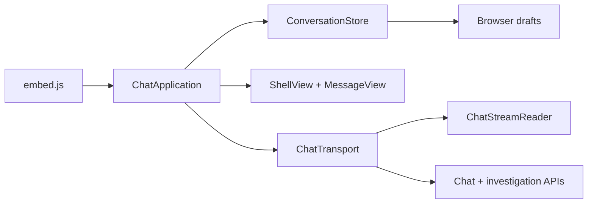

# Frontend and installation map

Start here for browser behavior, Mainsail access, or the optional OctoEverywhere
patch. Python services and investigation ownership remain in
[architecture.md](architecture.md) and [investigations.md](investigations.md).

## Browser composition

`web/app.py` reads `web/static/scripts.json` in order and bundles the scripts
and CSS into the page. There is no JavaScript build step or npm runtime dependency.
Root, `/embed`, and `/direct` serve the same self-contained, uncached page.
This is deliberate: OctoEverywhere's navigation helper can fetch `/direct` and
write that HTML into a popup without relying on separate asset requests.

| File under `klipperai_agent/web/static/` | Responsibility |
| --- | --- |
| `embed.js` | Construct the application, store, transport and view |
| `chat-application.js` | Bootstrap, restore, select, submit, delete and recheck; one operation at a time |
| `store.js`, `conversation.js` | Browser history, draft persistence, migration and value normalization |
| `transport.js` | Public API prefix, ephemeral sessions, one retry on expired sessions, HTTP operations |
| `agent.js` | SSE decoding and rendering public tool activity and next actions |
| `investigation.js` | Saved-turn conversion, dated evidence and manual review cards |
| `proposal-review-view.js` | Firmware evidence, option/version checks and manual verification steps inside review cards |
| `investigation-sync.js` | Refresh pending/recovered investigations while preserving drafts and active responses |
| `memory.js` | Explicit confirmation, linked dated evidence and forgetting printer facts/preferences/resolutions |
| `message-view.js`, `markdown.js` | Conversation text, source citations and text-only Markdown with copyable code blocks |
| `result-cards.js` | Findings, severity labels, evidence excerpts and editable follow-up questions |
| `ui-errors.js` | Session/setup/connection notices and recovery controls |
| `shell-view.js` | Chat history, composer, connection summary, dialogs, keyboard and scroll behavior |



The sidebar displays single-line conversation titles with settings at the bottom.
New chats show a centered greeting and composer; open chats use a readable text
column with user bubbles and unboxed agent replies. Provider, knowledge and memory
settings open as focused dialogs. The sidebar collapses on desktop and opens over
the conversation on small screens. Model text is rendered as text nodes, never interpreted as HTML.
The transport owns all session retry logic; renderers do not fetch data.

Provider settings separate Connection, Models and Usage limits into expandable
sections. Printer knowledge groups setup, references, connection checks, connector
observations and diagrams the same way. Component and model details open individually;
knowledge refreshes preserve expanded sections. Dialog titles and save actions stay
visible while their content scrolls.

The sidebar starts with lightweight investigation summaries. Full saved answers
load when a chat is opened; cached messages and drafts survive failed fetches.
History refresh slows to thirty seconds when idle, remains five seconds for pending
work, and pauses in hidden tabs. See [performance.md](performance.md) for measured
costs and the separate Linux/ARM acceptance requirements.

Enter sends a question; Shift+Enter adds a line. Starter questions fill the draft
without sending. New activity preserves the reading position when scrolled up;
the down-arrow returns to the latest message. Code blocks offer an explicit Copy
action. Dialogs contain keyboard focus and close with Escape or their backdrop.

The composer mode selector updates a per-conversation preference. Requests carry
that mode, and saved answer receipts render under **Context included**. Switching
keeps history; in-flight operations lock the selector. See [agent-modes.md](agent-modes.md).

## Results, automatic context and recovery

Answers display **Findings** and **Next actions** sections when those fields are
present. Findings retain their severity and source; **Evidence**, investigation
activity and usage receipts expand on request. Partial/error outcomes remain labeled when reopening a
chat. **Investigate finding**, **Analyze this source**, **Explain this check** and
the follow-up questions add an editable prompt to the composer, preserving an
existing draft. **Ask agent** sends it in the same investigation.

The composer contains the question, mode selector and send arrow (**Ask agent**).
Its footer identifies the active model and explains data sharing under **What's shared**.
It has no upload, drag-and-drop or snippet controls. Both modes collect the active
config tree and bounded recent host log tails before the first model call; Debug
adds live printer status and configured service diagnostics. The model can request
more details through read-only tools. Collection exclusions, permissions and
budgets remain visible as context gaps. Failed sends preserve the question draft.
Server-side redaction and investigation retention still apply. Existing API input
contracts and historical evidence remain readable for compatibility.

The header summarizes the printer connection, with detailed status in its popover. Host logs and on-disk config can
still be read when accessible. Missing OpenAI credentials link to Provider settings; the
agent remains unavailable until an API key is active. Expired UI sessions renew once;
failed renewal displays **Reconnect** without replaying the question. Connection
checks preserve the draft and do not start another analysis. Provider changes
still require a manual KlipperAI restart.

## Access paths

```mermaid
flowchart LR
    Mainsail[Mainsail navi.json] --> Local[nginx /klipperai/]
    Local --> Backend[KlipperAI on loopback]
    Remote[OctoEverywhere portal] --> Router[Optional patched OE router]
    Router --> Backend
    Remote --> Helper[OE navigation helper]
    Helper --> Direct[/klipperai/direct]
    Direct --> Router
```

nginx and the OE router strip the public prefix before forwarding. The service
passes its configured prefix to Uvicorn for correct mounted-asset routing.
The HTML and transport keep API requests under that prefix, including sessions,
SSE, history, deletion and proposal rechecks. Match the prefix and port across
KlipperAI settings, nginx, Mainsail navigation and OE patch options.

nginx redirects the bare prefix with a relative URL preserving query strings,
uses `^~` prefix precedence over Mainsail asset regexes, disables proxy caching
and response buffering, and permits long SSE reads. The OE router handles the bare prefix with
or without a query and preserves the remainder of the URL. A blocked popup falls
back to same-tab navigation. Failed popup URL replacement or invalid fetched HTML
falls back to a real page load.

## Installer ownership

`sh install.sh` starts with POSIX `bootstrap.sh` and `entware.sh`, detects the
package manager and installs Bash when missing before re-executing in Bash. The
ordered manifest is `deployment/installer/modules.txt`. Sourcing a module performs
no installation. `--help` and `--check` never install packages.
The entry point calls these phases:

1. `platform.sh`, `preflight.sh`, `prerequisites.sh`: Linux checks, systemd/native-init selection and missing prerequisite installation before command checks.
2. `configure-paths.sh`, `configure-options.sh`: account, paths and interactive choices.
3. `install-python-package.sh`: Python selection, virtual environment and package install.
4. `install-service-configuration.sh`: application settings, profile, Moonraker integration, selected service backend and nginx.
5. `install-access-integrations.sh`: chosen Mainsail and OE integration helpers.
6. `print-next-steps.sh`: installed paths and manual follow-up.

Supporting functions live in `common.sh`, `python.sh`, `accounts.sh`,
`discovery.sh`, `settings.sh`, `moonraker.sh`, `service.sh`, `nginx.sh`,
`integrations.sh`, and `summary.sh`. nginx validation failure stops reload and
restores both its previous server-block and proxy-snippet backups.

Native Creality/KE hosts use `deployment/appliance_*.py` for init lifecycle,
authenticated host-key credentials and RAM-only master delivery. Standard systemd
hosts retain `LoadCredentialEncrypted`. The SSH updater selects the installed
backend and updates both runtime code and native bootstrap modules from the wheel.
Only the application service/process is controlled. See [native setup](creality-compatibility.md).

Installation writes application/service/proxy configuration and selected access
integrations. It does not offer printer macros, shell-command extensions or edits
to `printer.cfg`. The application remains read-only toward printer files.
The separate historical macro installer is retained outside the guided flow.

The supported Mainsail sidebar integration uses `.theme/navi.json`.
It opens a new tab; the former topbar/iframe drawer source patch is retired.
The standalone page groups settings below chat history and keeps compact printer
status visible. See [Mainsail routing and page checks](mainsail-shell.md).
`integrations/mainsail/navigation.py` owns pure entry merging, `navigation_file.py`
owns snapshots/backups/atomic replacement, `nav_cli.py` owns manual and automatic
modes, and `nav_hook.py` installs the systemd watcher and timer. Automatic repair
checks at boot and every five minutes, as well as on file changes. Explicit
navigation removal pauses repair; full uninstall removes the units first.
Saved settings live beside the printer config directory, so boot checks do not
depend on an interactive shell environment. See the
[Mainsail maintenance guide](../integrations/mainsail/README.md).

The optional OE integration separates reversible text transformation
(`route_patch.py` and templates), deployment/backups (`patch_files.py`), recovery
state and process locking (`maintenance_state.py`), and update coordination
(`update_coordinator.py`). `maintenance.py` provides the administrative CLI;
shell entry points select the interpreter and install the systemd watcher/timer.
Missing or duplicate upstream anchors stop patching before either target changes.
Busy, missing or invalid Moonraker update state leaves the checkout and suspension
marker unchanged. Failed restarts and refreshes are retried without rewriting
current files. The generated runner retains its custom storage directory even
without `HOME` or environment overrides. See the
[OE maintenance guide](../integrations/octoeverywhere/README.md) for recovery state,
upgrade instructions and limits of coordination with external updaters.

## Verification

```sh
python -m pytest
node --test tests/*.test.mjs
sh install.sh --check
ruff check klipperai_agent tests tools integrations
ruff format --check klipperai_agent tests tools integrations
mypy klipperai_agent --ignore-missing-imports
mypy integrations --ignore-missing-imports
python tools/project_map.py --check
uv build
```

Python tests include temporary Mainsail/OE checkouts, fake service commands, a local
Moonraker update fixture, interrupted writes, process-lock contention, restart and
refresh retries, and HTTP tests at default/custom prefixes. The 100% statement
coverage gate includes the standalone Mainsail/OE helpers and shared process lock. JavaScript
tests load the script manifest and exercise transport, application composition,
DOM output and OE popup/rescue paths. These are automated checks, not a rendered
browser check or a live printer, nginx, OE tunnel or model-provider test.

For release validation, install the wheel outside the checkout and verify its
entry points, inline bundle, mounted assets and persistent investigations. The
source archive must also include the installer manifest, modules and integrations.
On a real Linux host, verify both local Mainsail and the OE portal, including a
streamed question, reload/restored history, manual proposal recheck and deletion.
